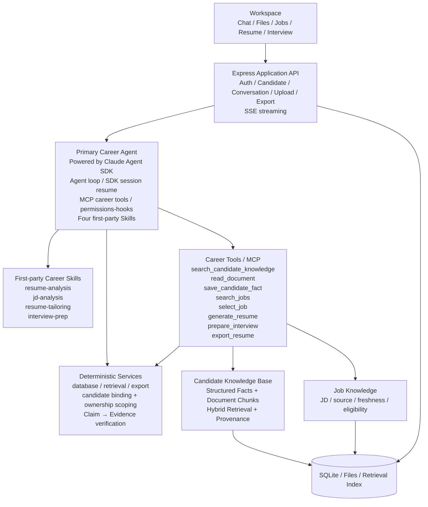

# Loomi Architecture

Updated: 2026-09-22
Status: P0 target architecture

## 1. What this project is

Loomi is a long-term Personal Career Agent.

Its core value is not “generate a resume once.” It is:

```text
build a trustworthy Candidate Knowledge Base
→ keep talking to the same candidate over time
→ retrieve the right background when needed
→ use career-specific Skills and Tools
→ produce grounded career outputs
```

The architecture deliberately stays small. There is one main Agent, one long-term candidate knowledge system, a small set of Skills/Tools, and deterministic verification around them.

## 2. Overall architecture



There is no Brain in the primary request path. `server/brain.js` and `knowledge/brain.md` are legacy migration only: do not extend them, and delete them once regression coverage equivalent to the Brain-era tests exists on the Primary Career Agent + Candidate KB path. The production request path is:

```text
Client
→ Express app (SSE)
→ Primary Career Agent (Claude Agent SDK:
     agent loop, MCP career tools,
     SDK session resume, four first-party Skills)
→ deterministic services (database / retrieval / export)
```

## 3. The key boundary: SDK runtime vs Loomi domain

### Claude Agent SDK owns generic agent behavior

Primary Career Agent is not a custom agent framework written by Loomi. It is an Agent powered by Claude Agent SDK.

Use SDK capabilities for generic runtime concerns whenever the installed version supports them:

- agent loop and multi-step execution;
- session / conversation continuity and resume;
- Skill discovery and use;
- Tool / MCP selection and execution loop;
- permissions / hooks;
- streaming, abort and runtime events;
- future subagent/task capabilities if P0 later proves they are needed.

Do not rebuild these above the SDK with a second Brain, custom planner, router Agent, or custom agent loop.

### Loomi owns career-domain state and truth

Loomi must own:

- Candidate identity and isolation;
- Candidate Knowledge Base;
- RAG / retrieval;
- Job Knowledge;
- first-party Career Skills;
- business Tools / MCP;
- evidence provenance;
- resume claim verification;
- persistent application history and artifacts.

A useful mental model is:

```text
Claude Agent SDK = how the Agent thinks and acts
Loomi  = what the Agent knows, can do, and is allowed to claim
```

## 4. Candidate is the long-lived entity

A user may manage more than one candidate. Every Conversation is bound to one `candidate_id`.

```text
User
├── Candidate A
│   ├── Documents
│   ├── Candidate Facts
│   ├── Conversations
│   ├── Target Jobs
│   └── Resume Variants
└── Candidate B
    └── isolated data
```

P0 does not silently switch Candidate inside one Conversation. Candidate ownership and filtering are deterministic application logic, not a prompt instruction.

## 5. Session, history, and long-term memory

Only two memory concepts are needed.

```text
Agent Session / Conversation History
= current Conversation continuity

Candidate Knowledge Base
= long-term candidate background across Conversations
```

Evidence / Provenance is not a third memory system. It is metadata attached to Candidate Facts that answers: “where did this fact come from?”

The application database persists Conversation History even when an SDK Session exists. If an SDK Session cannot be resumed, the application can rebuild useful context from Conversation History + Candidate KB.

### SDK Session persistence

P0 enables SDK session continuity instead of running the SDK stateless:

- `conversations.agent_session_id` stores the SDK session id for the conversation.
- The session id is captured from the SDK init / system event of the first turn.
- On follow-up messages, `claudeAgent` passes the persisted session id as the resume option so the SDK session continues.
- Only an explicit missing-session error before any tool invocation may restart from application history + Candidate KB. Provider failures or failures after a tool attempt are surfaced, never replayed.
- `user_id + candidate_id + conversation_id` hashes to a stable SDK workspace. Its isolated home/config directories are distinct from `cwd`, so project Skills remain discoverable without loading ambient user settings.
- Runtime traces distinguish discovered Skills, requested Skill calls, and successful Skill results. A Skill invocation alone does not prove a completed business operation.

## 6. Candidate Knowledge Base

Candidate KB combines structured truth with searchable source material.

### Structured Facts

Examples:

```text
education
experience
project
skill
achievement
metric
career_preference
```

A fact keeps provenance:

```text
fact_id
candidate_id
type
value
source_type
source_id
source_quote
source_page / source_position
confidence
status
```

Supported status values include `verified`, `user_asserted`, `disputed`, and `disabled`.

### Document Chunks

Original resumes, project descriptions, portfolios, internship summaries and other user material are chunked for retrieval while preserving source references.

### Retrieval

```text
Structured Fact Search
+
Keyword / BM25
+
Semantic Vector Search
→ deduplicate / rerank
→ bounded Evidence Pack
```

The Agent does not receive the entire Candidate KB. It calls `search_candidate_knowledge` and gets only relevant evidence.

### Hybrid retrieval implementation

P0 retrieval is hybrid over SQLite:

- an FTS5 index (`candidate_knowledge`) with the `bm25` ranking function covers `candidate_facts` and `document_chunks`;
- a Han-character bigram fallback is provided via a trigram/bigram text transform used as the tokenizer path when the default tokenizer cannot segment Chinese text;
- evidence pack assembly keeps the existing bounded result shape.

Scoping invariant: every FTS or fallback query is filtered by `user_id + candidate_id` before execution; an ownership violation throws — it is never silently narrowed.

## 7. Primary Career Agent

P0 has one Primary Career Agent.

It receives the user request and can autonomously:

```text
understand the request
→ choose an appropriate Skill
→ retrieve candidate/job evidence when needed
→ call business Tools
→ continue reasoning from Tool results
→ produce an answer or artifact
```

There is no `Brain LLM → Career Agent` chain in the target architecture.

The current `server/brain.js` / `knowledge/brain.md` path is legacy migration code. Do not expand it; remove it once the P0 request path no longer depends on it.

## 8. First-party Career Skills

P0 starts with four Skills:

```text
skills/
├── resume-analysis/
├── jd-analysis/
├── resume-tailoring/
└── interview-prep/
```

Skills contain domain methods, workflows and reference material. They do **not** contain a specific Candidate's facts.

They live under `.claude/skills/<name>/SKILL.md` and are loaded through the SDK's project skill discovery (`settingSources`), not a custom Skill registry. Task-specific methods are migrated from `knowledge/career-sop.md`, which remains migration source material only.

Keep the always-loaded Core Policy small. Put task-specific methods into Skills so the Agent can load them only when relevant.

Do not turn document parsing, retrieval, export, database writes, or job search into Skills when they are better represented as Tools/Services.

## 9. Career Tools / MCP

P0 tool surface stays intentionally small:

```text
search_candidate_knowledge
read_document
save_candidate_fact
search_jobs
select_job
generate_resume
prepare_interview
export_resume
```

The Agent decides when a Tool is useful. Deterministic server code / SDK permission controls decide whether that Tool is allowed and whether its inputs are valid.

The noninteractive SDK configuration uses `permissionPrompts: 'none'`, which does not invoke `canUseTool`. An unfiltered SDK `PreToolUse` hook checks exact registered MCP names/first-party Skills and cancellation before permission resolution; static allowed/disallowed tool rules remain. Real installed MCP schema validation rejects invalid parameters and strips unrecognized candidate selectors. Ownership and business authorization remain in the registered server callbacks, not in the hook or a decision model.

Do not use another LLM to generate `allowedTools`.

## 10. Grounding and verification

Grounding is a domain guarantee, not a separate Agent in P0.

```text
Source Document / explicit User Statement
        ↓
Candidate Fact + Provenance
        ↓
Resume Claim
        ↓
fact_ids / source evidence
```

A factual resume claim without support cannot enter the final resume.

Verification checks at least:

- unsupported technologies;
- unsupported metrics/results;
- inflated responsibility scope;
- JD requirements copied into candidate history;
- cross-Candidate contamination.

## 11. Job Knowledge

Candidate Knowledge and Job Knowledge are separate stores.

Job Knowledge may continue using the existing background synchronization and local snapshot approach. Preserve source URL/ID, observed/fetched times, freshness and validity state.

`server/officialJobSources.js` is the single registry of official employer sources. A source carries an adapter that knows how to read that specific company's data (`json-api`, embedded `html`, or `unadapted`), because these career sites are SPA-fronted APIs and no generic HTML scrape can read them. A source without an adapter is registered for provenance and reporting only: it is never fetched and never produces a record. Source status is therefore reported as `synced` / `reachable` / `unadapted` / `failed` / `idle`, so "this employer has no matching opening" is never confused with "this employer is not wired up yet".

Aggregator text is not automatically a full official JD. Missing requirements remain unverified. A job record is only accepted when its title, detail URL and host all belong to the declared official source.

P0 does not require job-monitoring UI, notifications or automated applications.

User-authorized Hiring Radar ingestion reuses this Job Knowledge service through a pinned local parser adapter. Deterministic cleaning quarantines recruitment events, labels recruitment batches, normalizes display names, and merges exact posting copies with per-source provenance. Original per-source records remain recoverable. No additional Agent, planner, upstream workspace or generic plugin surface is introduced. Runtime/setup, cleanup and failure contracts: `docs/job-ingestion.md`.

## 12. P0 data model

Keep the first model small:

```text
User
Candidate
Document
DocumentChunk
CandidateFact
Conversation
TargetJob
ResumeVariant
```

Key relations:

```text
Conversation
├── candidate_id
├── messages
└── agent_session_id

ResumeVariant
├── candidate_id
├── target_job_id
├── content
└── claim_evidence / fact_ids
```

Do not create Workflow, Worker Agent, Knowledge Graph or multi-agent state tables in P0.

### Persistence model details

- `target_jobs`: the JD / job a Candidate is targeting, scoped by `user_id + candidate_id`.
- `resume_variants`: persisted tailored resumes tied to a `target_job_id`.
- `claim_evidence`: per-claim mapping `(variant_id, claim_text, fact_ids)`.

Variant lifecycle:

```text
draft lives in agent context
→ generate_resume persists the variant with its claims
→ claim verification links each claim to fact_ids
→ export reads the persisted variant (never an ad-hoc draft)
```

## 13. Main P0 flow

### Candidate ingestion

```text
Upload / explicit user statement
→ parse / OCR
→ Document Chunks → Retrieval Index
→ Fact Extraction
→ normalize / conflict check
→ Candidate Facts + Provenance
```

### Targeted resume

```text
User + JD
→ Primary Career Agent (Claude Agent SDK)
→ jd-analysis
→ search_candidate_knowledge
→ Evidence Pack
→ resume-tailoring
→ generate_resume
→ Claim Verification
→ Resume Variant
→ PDF / DOCX
```

## 14. What is not P0

Future only unless evidence shows it is needed:

- Evidence / Targeting / Verification Worker Agents;
- custom multi-agent orchestration;
- large third-party Plugin ecosystem;
- Knowledge Graph;
- advanced reranking / Learning-to-Rank;
- Cover Letter / company research / application tracking / offer comparison;
- automatic application/submission (the explicitly requested local semi-automatic extension below is separate from P0);
- large evaluation or observability platform;
- fine-tuning.

If those features are added later, they should reuse Claude Agent SDK + Candidate KB + Skills + Tools instead of introducing another generic agent framework.

## 15. Migration from the current repository

As verified on 2026-10-08, the default Primary Career Agent uses Claude Agent SDK `query()`, session resume, four first-party Skills, scoped MCP career tools and abort handling. The four Skills have successful real-provider invocation evidence. Arbitrary filesystem/shell tools, third-party Plugins and Agent/Task remain disabled. `package.json` pins `@anthropic-ai/claude-agent-sdk` to `0.3.269`.

P0 migration should therefore focus on enabling the SDK capabilities the product actually needs instead of rewriting the runtime:

```text
1. establish the four Career Skills
2. stop routing every turn through Brain LLM
3. add Candidate + CandidateFact + DocumentChunk
4. add search_candidate_knowledge
5. enable Conversation / SDK Session continuity
6. wire JD → RAG → tailoring → verification → export
7. remove legacy Brain code after the new path passes tests
```

Implementation rules live in `DEVELOPMENT_RULES.md`; product scope lives in `PRD.md`.

## 16. User-requested local semi-automatic application extension

This is an opt-in extension, not a second primary agent or a P0 workflow engine. The single Career Agent may load `application-form` for an explicit present-turn fill request. A preference such as “default to blank fields” is not permission to mutate a webpage now.

`applicationRoutes` binds each service action to an owned user/candidate/conversation and restricts HTTP and chat access to local clients. A dedicated visible local browser is opened only by the user. The application does not attach to unrelated browser windows or reuse BOSS state.

`applicationProfile` encrypts explicitly provided personal/preferences/experience records per user+candidate using AES-GCM and a local key. Sensitive field values are never returned in public profile responses or passed to the answer model. `applicationAnswers` selects known values and can ask the existing model helper for bounded, fact-linked open answers; all claims are revalidated.

`applicationForms` scans native fields without reading occupied values back, binds handles to the exact page/document, and combines the final blank check with each native value write in one synchronous DOM operation. Radio groups are scoped to their original form; repeated records use stable row identity and include disabled/hidden rows when determining the record slot. Ambiguous rows are left for manual entry. It reports filled/preserved/missing/failed controls. Existing values, including zero and selected false, are retained. It never clicks submit/send/sign/consent. Pages may autosave during entry; manual final submission does not imply no data has been sent.

Every native write also checks the scanned field's full private label/section and actual form/row object identity. Radio/select membership, option objects, full option labels (including accessible names/references and native `option.label`), values and disabled state are checked before choosing a target; the first radio alone cannot stand in for the whole group. Public descriptors and private identities are captured in one synchronous DOM read. Same-document SPA control reuse invalidates the old mapping; public descriptor truncation cannot hide purpose drift or consent text. Forbidden-purpose matching covers full control/group/option purposes before display truncation, while the private browser snapshot is not passed to the Agent or JEV.

Acceptance covers real local DOMs and the workspace→HTTP→encrypted profile→browser path. ARIA single-select comboboxes use explicitly bound listboxes and exact unique option labels. Same-origin nested frames retain document and ancestor-frame identities through scanning and writes. The Jiandaoyun adapter supports text, radio, single and multiple choices, committed ISO dates and bounded native file selection; award-proof file selection binds the exact source row, newly opened unique popup and native input. Unsupported subform selectors remain explicit. Attachment selection reports attachment_selected and remains pending; it does not count as filled or prove server acceptance. Multiple choices require a complete exact option preflight and preserve intervening selections. `applicationRows` adds only bounded rows from confirmed education/employment/projects/awards/campusLeadership profile counts, with unique add buttons and document/container/old-row verification; adding invalidates the scan. Ambiguous controls, unverified date panels/cascaders, automatic page navigation and cross-origin frames remain manual. A configured Primary Career Agent filled and independently verified four source-known fields on the supplied public recruitment page; this is a sample, not full-page acceptance. Synthetic portal consistency checks keep their source, coverage and network boundaries separate from that real-source sample.

Attachment selection is UI/HTTP-only: the user selects an owned Candidate document for each scanned empty native file input, then explicitly invokes fill. Chat/JEV do not choose documents; arbitrary paths/buffers are not API inputs. Files come only from the canonical private upload directory, have supported PDF/DOCX/TXT/Markdown names, and are bounded to 8MB total distinct file bytes per fill. Document identity, ownership and filesystem identity/stamps are rechecked before individual writes and after asynchronous receipt verification. Changed accept, purpose labels, sections, form/row ownership or intervening user selections prevent replacement. File contents never enter model inputs or fill responses; website input handlers may upload immediately. Generated Resume Variants are not silently substituted for original documents.

Ordinary Jiandaoyun attachments report `attachment_uploaded` only after verifying the same-frame source-widget token request, unique token and specified upload URL, exact multipart original bytes, response for that same upload request, and exact filename in the original source DOM. Received attachments have a separate count propagated through HTTP, panel and Career Agent summaries. The user-authorized original resume passed this real upload check. Proof popups retain selection-only status; other upload chains cannot inherit this receipt guarantee.

Neither an unchecked checkbox nor native `indeterminate` proves an unanswered field: it may represent an explicit false or existing aggregate selections. Native checkboxes remain manual until a portal adapter can establish their unanswered semantics. Boolean radio/select fields with an observable unselected state remain supported; selected false is preserved. Submit/consent/signature controls are never eligible.

`jevClient` provides a bounded TypeSafe System One client for typed Choice/Score/Noul responses, with isolated credential loading, cancellation, timeout and schema validation. The application uses Choice only for otherwise-unmapped, fixed public field-purpose phrases. Personal values, URLs and arbitrary labels never enter this request. Missing credentials, failure, ambiguity or low confidence leave fields for manual review. Results report `realJevCalled` only after a validated provider response; method-only and failed paths never claim a call. JEV does not supply facts, authorize writes, or run another agent loop. Every fact-backed answer and the conversation binding are revalidated after asynchronous decisions and before individual browser write requests.

`semanticRetrieval` adds bounded numeric dense-vector retrieval and reciprocal-rank fusion with structured/FTS evidence. Its persisted embedding cache is derived, scoped by user+candidate+provider namespace+record content hash, and never replaces authoritative fact/source validation. `embeddingClient` supports an explicitly configured, already-installed local Ollama model with digest checks before/after embedding, the explicitly requested Qianwen cloud model through `cloudEmbeddingClient`, or Google `gemini-embedding-001` through `googleEmbeddingClient`; no models are installed and chat/JEV credentials are never reused. The cloud paths accept only their selected HTTPS endpoint and pinned model: Qianwen splits batches to 20 over one compatible endpoint, while Google sends one `embedContent` request per text with `RETRIEVAL_QUERY`/`RETRIEVAL_DOCUMENT` task types and a `x-goog-api-key` header; both validate response identity/dimensions/numeric values, bound streams/timeouts, refuse redirects and never retry a failed request. When the process has `HTTPS_PROXY`/`HTTP_PROXY`, the configured Google transport routes through an undici ProxyAgent scoped to embedding only. Cache namespaces include endpoint/model/dimensions/explicit revision; a mutable cloud model alias is not an immutable digest. Index/query texts from the scoped Candidate KB can leave the machine when cloud retrieval is selected; application-profile secrets and attachment bytes do not enter this service. Standard npm server/app commands explicitly load optional ignored `.env.embedding`, while ordinary tests and the default acceptance script do not. Both Agent and HTTP knowledge search use the same retrieval service; unconfigured/failed semantic paths remain explicit and retain lexical retrieval. Model quality must be proved by actual acceptance, not transport fixtures; 2026-10-10 live acceptance passed six of six bilingual rank/margin cases with gemini-embedding-001 at 768 dimensions, where Qianwen had passed two of six under the unchanged gate; post-rotation live JEV and real portal acceptance remain separate outstanding work.

## User-requested resume layout extension

`resume-layout` is an additional first-party SDK Skill for presentation of persisted grounded variants. It uses the existing `export_resume` tool with validated template/section order options and the existing PDF/DOCX renderer. `server/resume_layouts.json` owns reusable style resources. No second Agent, planner, content rewrite or Candidate Fact storage is introduced. Inline PDF preview uses the same owned conversation/variant and revalidates evidence. See `docs/resume-layout.md`.
